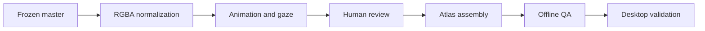

# Rei Desktop Pet | 绫波丽桌面宠物

**A multi-variant, unofficial EVA-inspired desktop pet engineering project for Codex Desktop Pets.**

面向 Codex Desktop Pets v2 的三形态桌宠工程实践，以角色美术一致性、标准化动画资产、跨平台构建和可追溯验收为核心。

> **Project status / 项目状态：** 三套标准动作及方向帧已完成人工美术验收；P4-D 扩展图集候选在独立分支完成离线 QA。正式三套 Windows 实机终验与 v1.0.0 发布尚未从已读仓库记录确认。

## Character variants / 角色版本

| Pet ID | 角色形态 | Standard frames | Gaze frames |
| --- | --- | ---: | ---: |
| `rei-school` | 校服 | 57 | 16 |
| `rei-white` | 白色战斗服（00） | 57 | 16 |
| `rei-black` | 黑色战斗服（09） | 57 | 16 |

Three independent pets; no runtime outfit switching. 三套独立宠物，不包含运行时形态热切换。

## Technical specifications / 技术规格

| Specification | Value |
| --- | --- |
| Frame canvas | 192 × 208 RGBA |
| Neutral character height | 188 px |
| Foot anchor | (96, 195) |
| Standard atlas | 1536 × 1872, 9 rows |
| Extended v2 atlas | 1536 × 2288, 8 × 11 grid |
| Occupied cells per v2 atlas | 57 animation + 16 gaze + 1 neutral |
| Candidate delivery format | Lossless WebP + pet.json |
| Processing | Python / Pillow |

Nine standard states: `idle`, `running-right`, `running-left`, `waving`, `jumping`, `failed`, `waiting`, `running`, `review`.

## Engineering workflow / 工程流程

- **Art acceptance:** 171 standard frames and 48 direction frames recorded as accepted by the user.
- **Reproducibility:** Linux cloud reconstruction of three standard atlases recorded as pixel-identical and PNG SHA-256 identical to the Windows baseline.
- **Runtime compatibility:** a temporary v2 compatibility package passed basic Windows runtime testing; detailed event and direction behavior remains separate from that result.
- **Final candidate:** 264 atlas cells across three variants passed offline QA on the P4-D development branch; this is not equivalent to final installation acceptance.

## Documentation / 工程文档

| Resource | 内容 |
| --- | --- |
| [Project status](PROJECT_STATUS.md) | main 分支阶段记录与证据 |
| [Asuka reuse matrix](01_设计规范/ASUKA_REUSE_MATRIX.md) | 从明日香项目继承的工程能力 |
| [Reproducibility](REPRODUCIBILITY.md) | 资产完整性与标准图集重建 |
| [Cloud validation](CLOUD_REPRODUCIBILITY_REPORT.md) | 跨平台复算证据 |
| [Atlas tools](06_共用工具/rei_atlas_tools.py) | 跨平台图集工具 |
| [Desktop Pet Developer skill](docs/DESKTOP_PET_DEVELOPER_SKILL.md) | 通用桌宠开发流程（可移植技能说明 V1.0） |
| [Compatibility notes](09_项目文档/CODEX_PETS_COMPATIBILITY.md) | 原生协议验证边界 |
| [P4-D candidate status](https://github.com/waynewayne893/rei-desktop-pet/blob/58e9fe1aff810dd4e64b4605f4f29b32c6b24b14/PROJECT_STATUS.md) | 独立分支候选装配与离线 QA 记录 |
| [Agent guidelines](AGENTS.md) / [Handoff](HANDOFF.md) | 工程保护及接续入口 |

## Related project / 关联项目

The [Asuka Desktop Pet project](https://github.com/waynewayne893/asuka-desktop-pet) established the character-to-atlas workflow. Rei extends it with parameterized normalization, staged human review, cloud reconstruction and structured validation.

## Rights and release scope / 权利与发布范围

This is an unofficial fan project, not affiliated with or endorsed by the EVA rights holders or OpenAI. Character designs, franchise names and trademarks remain subject to their respective owners' rights.

当前仓库公开可见，但历史工程规则仍要求私有管理；公开可见不等于已经完成授权审查、开源许可或公开发行。当前 main 未发现仓库级 LICENSE，不能据此推定工具或素材获准再分发。正式素材授权及公开发布条件需另行核实；本首页不新增素材下载推广或正式公开发行入口。

---

*Personal engineering portfolio · GitHub-first · Cross-platform asset pipeline · Human-in-the-loop QA*
