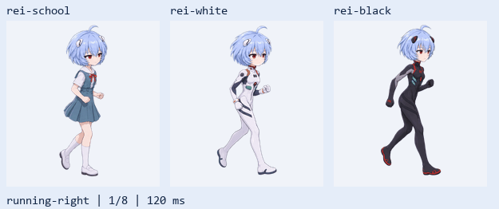
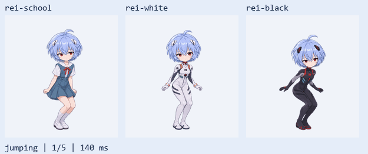
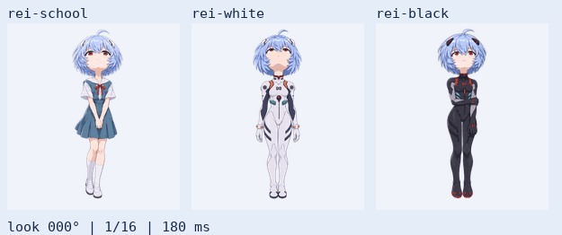
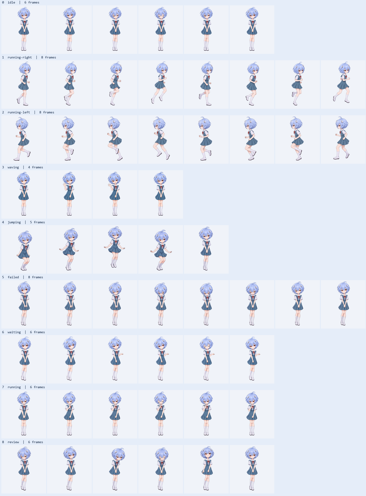
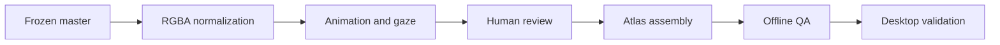

# Rei Desktop Pet | 绫波丽桌面宠物

**EVA Desktop Pets Series** · [Asuka](https://github.com/waynewayne893/asuka-desktop-pet) · [Rei](https://github.com/waynewayne893/rei-desktop-pet)

**A multi-variant, unofficial EVA-inspired desktop pet engineering project for Codex Desktop Pets.**

面向 Codex Desktop Pets v2 的三形态桌宠工程实践，以角色美术一致性、标准化动画资产、跨平台构建和可追溯验收为核心。

> **Project status / 项目状态：** 三套标准动作（171 帧）及 16 方向注视（48 帧）已完成人工美术验收。P4-D 扩展图集候选（三套 1536 × 2288 v2 包）在独立分支 `fix/p4d-package-integrity`（`58e9fe1`）完成离线 QA，**尚未合并到 main**。三套 Windows 实机终验（P5）与正式 v1.0 Release **尚未完成**。本页不提供安装包下载。公开展示不等于开源或获得素材再分发授权。

## ✨ Featured: 三形态绫波丽 / Three-outfit Rei

  
  
  

Three independent Codex Desktop Pets of Rei Ayanami — school uniform, white plugsuit (00), and black plugsuit (09) — each with 9 standard animation states and 16 pointer-following gaze directions. Art for all 171 standard frames and 48 gaze frames has been accepted. The v2 extended atlas packages have passed offline QA on a development branch and are **not** yet runtime-accepted or released.

三套独立的 Codex 桌面宠物：校服、白色战斗服（00）、黑色战斗服（09），各含 9 种标准动画与 16 个跟随鼠标的注视方向。全部标准动作与注视帧已完成人工验收。v2 扩展图集候选已在开发分支通过离线 QA，**尚未**完成实机终验，也尚未发布 Release。

**Standard atlas preview / 标准图集预览** (`rei-school`, 1536 × 1872, 8 × 9 cells of 192 × 208 · 57 filled / 15 blank):

White and black contact sheets: [白色战斗服](04_白色战斗服/P4-B/delivery/standard-contact-sheet.png) · [黑色战斗服](05_黑色战斗服/P4-B/delivery/standard-contact-sheet.png).

### States / 动画状态

`idle` 6 · `running-right` 8 · `running-left` 8 · `waving` 4 · `jumping` 5 · `failed` 8 · `waiting` 6 · `running` (working/thinking pose) 6 · `review` 6 · gaze: 16 directions (000° up … 090° right … 180° down … 270° left, clockwise).

Per-state three-form GIFs already on `main`: [`07_QA验收/P4-B/comparison-gifs/`](07_QA验收/P4-B/comparison-gifs/). The gaze sweep is a new preview assembled 1:1 from accepted P4-C frames: [`previews/qa/`](previews/qa/).

### Current status / 当前状态

- **Art acceptance:** 171/171 standard frames and 48/48 gaze frames recorded as accepted.
- **Reproducibility:** Linux cloud reconstruction of the three standard atlases recorded as pixel-identical and PNG SHA-256 identical to the Windows baseline.
- **Runtime compatibility:** a temporary v2 compatibility package was ruled `BASE_RUNTIME_COMPATIBILITY_PASS` / `DETAILED_RUNTIME_VERIFICATION_PARTIAL`. Per-sector gaze mapping, several task-triggered animations, and full quit-and-relaunch persistence remain unverified.
- **P4-D candidate:** three extended 1536 × 2288 atlases (74 filled / 14 blank cells each, including `R0C6`) and offline QA live on `fix/p4d-package-integrity` @ `58e9fe1`. That branch has **not** been merged into `main`. Windows P5 installation acceptance of the three packages has not been recorded.
- **Release:** there is no v1.0 GitHub Release. This page does not add a package download.

### Install / 安装

There is currently **no public install package or GitHub Release** for Rei. A formal publication is pending Windows P5 runtime acceptance of the three candidate v2 packages and an explicit owner decision. Asset redistribution rights remain unverified.

当前没有公开发布的安装包。正式发布需等待三套候选包完成 Windows 实机终验，并由所有者另行决定。素材再分发权利仍未核实。

When a package is published, the intended local path follows the Codex Desktop Pets convention: unzip so that `pet.json` and `spritesheet.webp` sit in `%USERPROFILE%\.codex\pets\<pet-id>\` (`rei-school`, `rei-white`, or `rei-black`), then in Codex Desktop open **Settings → Pets**, click **Refresh**, and select the pet.

Sister project: the Asuka repo has a published package for **明日香·黄裙夏日版 V1.0** — see [asuka-desktop-pet](https://github.com/waynewayne893/asuka-desktop-pet) and the [asuka-summer-v1.0 Release](https://github.com/waynewayne893/asuka-desktop-pet/releases/tag/asuka-summer-v1.0).

### Credits and workflow / 制作流程

Frames were produced from frozen masters, then taken through parameterized RGBA normalization (scale and translate; no redrawing of accepted art), staged human review, atlas assembly, offline QA, and cloud reconstruction under a shared v2 atlas protocol (192 × 208 cells). The [Desktop Pet Developer skill](docs/DESKTOP_PET_DEVELOPER_SKILL.md) records the reusable pipeline.

## Character variants / 角色版本

| Pet ID | 角色形态 | Standard frames | Gaze frames | Recorded status |
| --- | --- | ---: | ---: | --- |
| `rei-school` | 校服 | 57 | 16 | 人工美术验收通过；标准图集在 main |
| `rei-white` | 白色战斗服（00） | 57 | 16 | 人工美术验收通过；标准图集在 main |
| `rei-black` | 黑色战斗服（09） | 57 | 16 | 人工美术验收通过；标准图集在 main |

Three independent pets; no runtime outfit switching. 三套独立宠物，不包含运行时形态热切换。Extended v2 packages remain on the unmerged P4-D branch pending P5 and a release decision.

## Technical specifications / 技术规格

| Specification | Value |
| --- | --- |
| Frame canvas | 192 × 208 RGBA |
| Neutral character height | 188 px |
| Foot anchor | (96, 195) |
| Standard atlas (on `main`) | 1536 × 1872, 9 rows |
| Extended v2 atlas (candidate branch) | 1536 × 2288, 8 × 11 grid |
| Occupied cells per v2 atlas | 57 animation + 16 gaze + 1 neutral (`R0C6`) |
| Candidate delivery format | Lossless WebP + pet.json |
| Processing | Python / Pillow |

## Engineering workflow / 工程流程

## Documentation / 工程文档

| Resource | 内容 |
| --- | --- |
| [Project status](PROJECT_STATUS.md) | main 分支阶段记录与证据（部分条目可能滞后于后续分支工作） |
| [Asuka reuse matrix](01_设计规范/ASUKA_REUSE_MATRIX.md) | 从明日香项目继承的工程能力 |
| [Reproducibility](REPRODUCIBILITY.md) | 资产完整性与标准图集重建 |
| [Cloud validation](CLOUD_REPRODUCIBILITY_REPORT.md) | 跨平台复算证据 |
| [Atlas tools](06_共用工具/rei_atlas_tools.py) | 跨平台图集工具 |
| [Desktop Pet Developer skill](docs/DESKTOP_PET_DEVELOPER_SKILL.md) | 通用桌宠开发流程（可移植技能说明） |
| [Compatibility notes](09_项目文档/CODEX_PETS_COMPATIBILITY.md) | 原生协议验证边界 |
| [P4-D candidate status](https://github.com/waynewayne893/rei-desktop-pet/blob/58e9fe1aff810dd4e64b4605f4f29b32c6b24b14/PROJECT_STATUS.md) | 独立分支候选装配与离线 QA 记录 |
| [Agent guidelines](AGENTS.md) / [Handoff](HANDOFF.md) | 工程保护及接续入口 |

## Related project / 关联项目

The [Asuka Desktop Pet project](https://github.com/waynewayne893/asuka-desktop-pet) established the character-to-atlas workflow. Rei extends it with parameterized normalization, staged human review, cloud reconstruction and structured validation. Asuka’s latest published variant is **[明日香·黄裙夏日版 V1.0](https://github.com/waynewayne893/asuka-desktop-pet/releases/tag/asuka-summer-v1.0)**.

## Rights and release scope / 权利与发布范围

This is an unofficial fan project, not affiliated with or endorsed by the EVA rights holders or OpenAI. Character designs, franchise names and trademarks remain subject to their respective owners' rights. This is not an official product.

当前仓库公开可见，但公开可见不等于已经完成授权审查、开源许可或公开发行。当前 main 未发现仓库级 LICENSE，不能据此推定工具或素材获准再分发。正式素材授权及公开发布条件需另行核实；本首页不新增素材下载推广或正式公开发行入口。素材权利仍未核实，相关素材存在被权利人要求下架的风险。

> **Disclaimer / 声明：** Unofficial fan work. The character and franchise belong to their respective rights holders; this is not affiliated with or endorsed by them or OpenAI. Nothing on this page is a license or rights clearance. 非官方粉丝作品，角色及相关权利归其权利人所有；本页内容不构成授权。

---

*Personal engineering portfolio · GitHub-first · Cross-platform asset pipeline · Human-in-the-loop QA*
